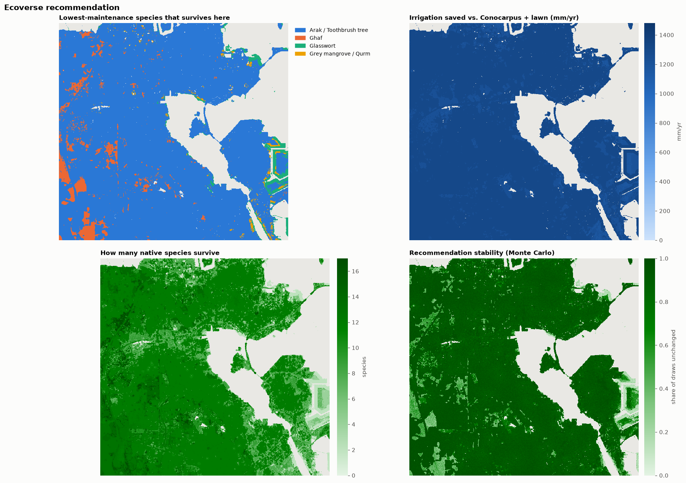
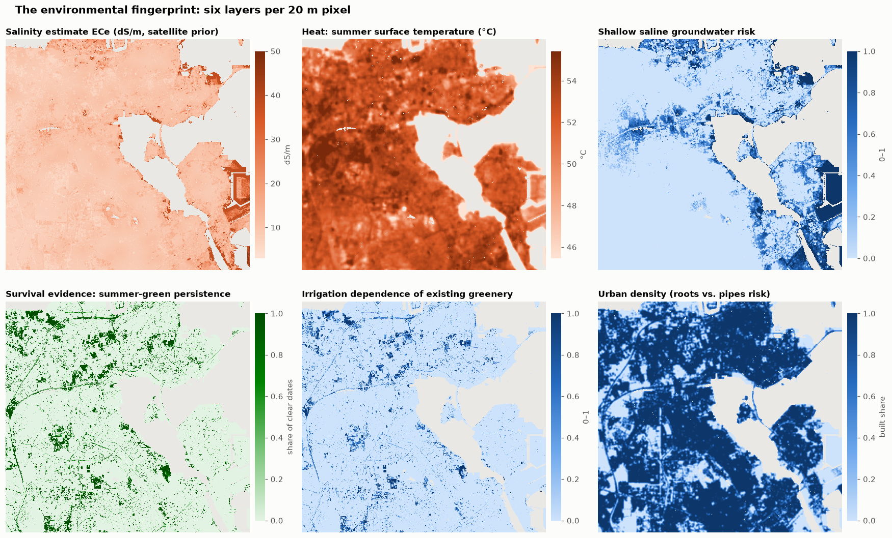
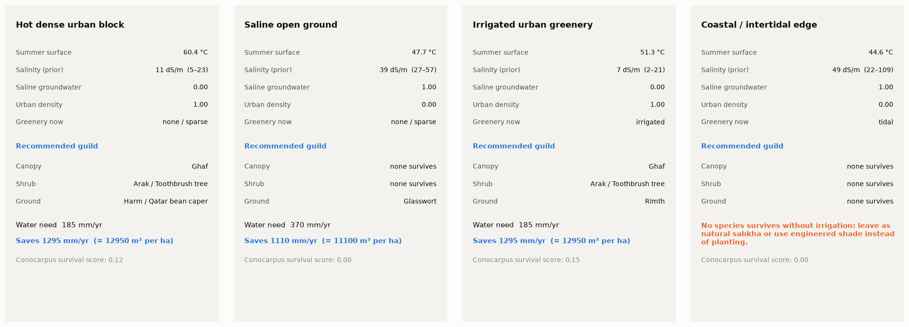
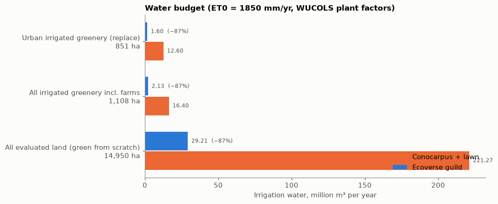
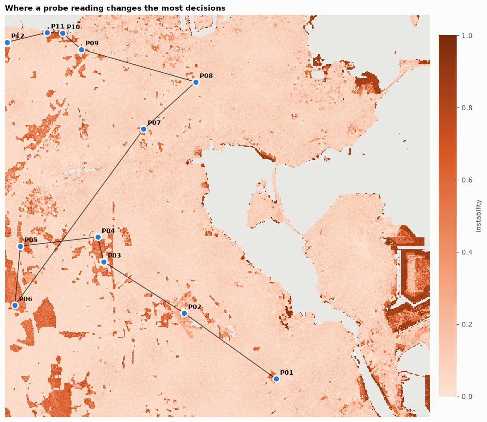
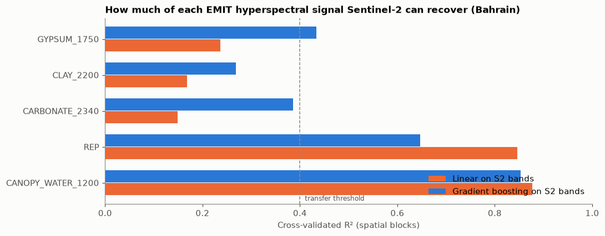
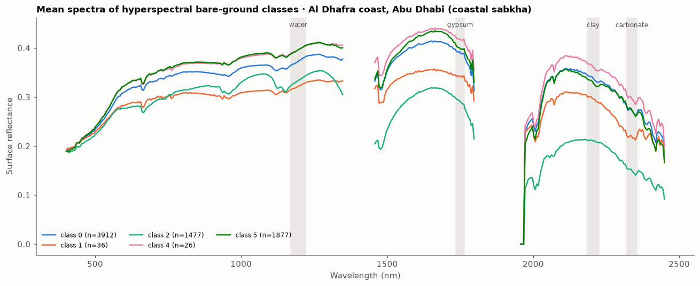

# Ecoverse 813 — plant what the ground already wants

**Team:** Ecoverse 813 (see [Team](#10-team-licence-and-attribution)) · **Country:** Kingdom of Bahrain ·
**Theme 05 — Sustainable Urban Planning & Smart Cities** · Arab Youth Space Hackathon: 813 Challenge (Proof of Concept)

**One line:** Ecoverse builds a satellite *environmental fingerprint* (heat, salinity, saline groundwater, moisture,
survival evidence, urban density) for every 20 m patch of northern-central Bahrain and recommends the
**lowest-maintenance native plant guild that can survive there**, together with the irrigation water it saves and
a field-probe route that targets the places where the satellite estimate is least certain.



---

## 1. Title and one-line summary
See above. The PoC runs on open data only (Sentinel-2, Landsat, Copernicus DEM, ESA WorldCover, Planet Tanager open
archive) and is built so that **Satellite 813** hyperspectral data drops in during incubation.

## 2. The business use case
| | |
|---|---|
| **User** | Municipal landscaping planners (Ministry of Municipalities Affairs & Agriculture and the four municipalities), real-estate developers, landscape contractors. |
| **Decision** | Which canopy tree, shrub and groundcover to plant — or replant — on a given site, and which existing irrigated plantings to convert first. |
| **What they use today** | Generic species lists, nursery availability and habit. Failures are hidden by extra irrigation, replacement and pruning. |
| **What Ecoverse gives them** | A district map of the lowest-water guild that survives each patch, a one-page **site card** per project, the water saved vs. business-as-usual, and a **probe route** for the sites that need a ground check. |
| **Why it can scale** | Free satellite data now; Satellite 813 later; a ≈ USD 100 probe kit; one analyst per municipality. Revenue: per-district subscription or per-project site report. |

## 3. The problem
- Bahrain's reference evapotranspiration is about **1,850 mm/yr** against **≈ 75 mm** of rain ([Fanack Water](https://water.fanack.com/bahrain/water-resources-bahrain/); [FAO AQUASTAT](https://www.fao.org/4/w4356e/w4356e09.HTM)). Ornamental plantings survive on desalinated water or groundwater.
- Soils are **saline and calcareous**: irrigated soils 4–12 dS/m, abandoned farmland up to 60 dS/m, shallow saline groundwater along the coast (FAO AQUASTAT).
- The default fast-growing street tree, *Conocarpus*, was **banned for new planting in Bahrain in 2022** because its roots damage pipes, drains and walls ([GDN Online](https://www.gdnonline.com/Details/1372822)); Qatar did the same in 2017.
- Native species that already survive these conditions (ghaf, sidr, arak, rimth, halophytes) exist, but there is **no site-specific way** to know which one fits which patch.

**Why satellites:** the deciding factors — heat, surface salinity, saline groundwater, whether vegetation survives the summer
without rain — vary block by block and change over seasons. Only satellites observe all of them, everywhere, repeatedly, at
near-zero marginal cost. Hyperspectral sensors add soil mineralogy (gypsum, carbonate, clay) and early plant stress that broad
bands cannot resolve — which is exactly what Satellite 813 provides.

## 4. Data used
| Dataset | Provider / access | Dates | Processing level | Licence |
|---|---|---|---|---|
| Sentinel-2 MSI L2A, bands B02–B07, B8A, B11, B12, SCL | ESA Copernicus via Microsoft Planetary Computer STAC (`sentinel-2-l2a`) | Summer 2025-06-01 → 08-31; winter 2025-12-01 → 2026-02-28; scene cloud < 20 % | L2A surface reflectance, baseline ≥ 04.00 (offset −1000 applied), SCL-masked, per-pixel median | Copernicus free & open |
| Landsat 8/9 Collection 2 L2, `lwir11` + `QA_PIXEL` | USGS via Planetary Computer (`landsat-c2-l2`) | Summer 2025; cloud < 30 % | Surface temperature (scale 0.00341802, offset 149 K), QA-masked median | Public domain |
| Copernicus DEM GLO-30 | ESA / Airbus via Planetary Computer (`cop-dem-glo-30`) | 2021 release | 30 m DSM, resampled to 20 m | Copernicus DEM licence |
| ESA WorldCover | ESA via Planetary Computer (`esa-worldcover`) | 2021 (v200) | 10 m land cover, mode-resampled | CC BY 4.0 |
| Planet Tanager hyperspectral (open archive) | Planet open STAC: `coastal-water-bodies/20250511_074311_00_4001` (Abu Dhabi Al Dhafra coast), `urban/20250515_080954_16_4001` (Riyadh), `natural-lands/20250608_074757_58_4001` (Rub al Khali margin) | 2025-05 to 2025-06 | Surface-reflectance HDF5, 426 bands 380–2500 nm; water-vapour and > 2450 nm bands removed | Planet open data (CC BY 4.0) |
| Plant trait table (26 species) | FAO, ICBA Biosaline, peer-reviewed salinity trials, Gulf floras — one source URL per row in `data/plants/bahrain_plant_traits.csv` | — | Curated; `salinity_basis` F = from source, F/E = converted, E = expert estimate | Facts cited with attribution |

Exact AOI, dates and limits are in [`src/ecoverse/config.py`](src/ecoverse/config.py); every STAC item ID actually used is
recorded in `data/sample_input/bahrain_aoi_stack_metadata.json` and `data/sample_input/tanager_gulf/*_meta.json`.

**AOI:** lon 50.50–50.64 E, lat 26.12–26.24 N (≈ 14 × 13 km): Manama, Tubli Bay mangroves, Isa Town, Sitra — a deliberate
gradient from intertidal flats to dense urban fabric to irrigated date-palm belts.

## 5. Technical approach (execution order)
```
open data ─► hyperspectral bridge ─► fingerprint ─► survival model ─► guild optimiser ─► water budget
                                                                           │
                                                   Monte Carlo stability ◄─┘─► probe route ─► ground fusion ─► updated map
```
1. **Compositing** (`fetch.py`): SCL/QA-masked medians for summer and winter; *summer-green persistence* = share of clear
   summer dates with NDVI > 0.25 (Bahrain gets ~no summer rain, so persistent green that is not tidal is irrigated or groundwater-fed).
2. **Hyperspectral bridge** (`hyperspectral.py`, notebook 01): on Tanager Gulf scenes compute continuum-removed absorption
   depths — gypsum 1750 nm, clay 2200 nm, carbonate 2340 nm, canopy water 1200 nm — and red-edge position; simulate Sentinel-2
   with Gaussian spectral responses; train gradient-boosted S2 → feature models with **5-fold spatially-blocked CV**
   (32 × 32 px blocks). Only features with CV R² ≥ 0.4 are transferred to Bahrain; the rest quantify what Satellite 813 adds.
   Also: cluster bare-ground pixels on these absorption depths and measure how well Sentinel-2 can recover those classes.
3. **Fingerprint** (`fingerprint.py`): NDVI, NDRE, NDMI, MNDWI, NDBI, salinity indices SI = √(B·R), SI2, SWIR ratio;
   distance to sea; intertidal mask; **salinity pressure** (spectral salinity + mineral proxy on bare ground, low elevation,
   coastal proximity) mapped log-linearly to an ECe prior of 3–50 dS/m with per-pixel uncertainty; waterlogging risk;
   urban density (50 m window); k-means **micro-habitat archetypes**.
4. **Survival model** (`plants.py`): per species, 0–1 response curves for salinity (ECe comfort → survival limit), heat,
   drought, waterlogging, habitat (tidal / wet-sabkha / sand), pH and root-vs-infrastructure risk; survival = product.
5. **Guild optimiser** (`recommend.py`): among natives with survival ≥ 0.6, per layer maximise
   `survival − 0.6·plant_factor − 0.08·(maintenance−1) + 0.15·shade·heat_need`.
6. **Water** : WUCOLS-style plant factor × ET0 1,850 mm/yr, guild cover 40/30/30 %, vs. baseline Conocarpus + lawn (factor 0.8).
7. **Robustness** (`uncertainty.py`): 40-draw Monte Carlo over salinity (per-pixel + AOI-wide shift), heat, waterlogging,
   pH and ET0 (1,800–2,100 mm) → stability map and confidence interval on savings.
8. **Probe loop**: greedy selection of 12 sites ≥ 500 m apart maximising instability × decision value, nearest-neighbour
   route; readings fused by Gaussian-kernel residual kriging (600 m range), shrinking uncertainty locally.

Random seed 813 everywhere.

## 6. Installation
Requires **Python 3.12** (3.13 also tested).
```bash
git clone https://github.com/saraabutaleb/Eco-verse-813.git
cd Eco-verse-813
python -m venv .venv && source .venv/bin/activate      # Windows: .venv\Scripts\activate
pip install -r requirements.txt
```
No API keys or tokens are needed — every data source is open.

## 7. How to run
**Reproduce the headline result from the committed sample data (offline, ≈ 3 min, no GPU):**
```bash
jupyter lab notebooks/02_main_analysis.ipynb      # Run All
```
It reads `data/sample_input/bahrain_aoi_stack.tif` (+ `tanager_gulf/`) and writes figures, GeoTIFFs and CSVs to `results/`.
The hyperspectral analysis is `notebooks/01_hyperspectral_gulf_calibration.ipynb` (≈ 1 min).

**Re-run everything from scratch** (downloads data, ≈ 15–30 min, most of it two Tanager HDF5 files of 1–5 GB each):
```bash
python scripts/fetch_data.py          # writes data/sample_input/ (add --skip-tanager for a 5-min run)
python scripts/run_all.py             # executes notebooks 01 and 02, builds docs/slides.pdf, refreshes this README's results
pytest -q                             # offline unit tests on synthetic fixtures
```
Or open [`notebooks/00_run_everything_colab.ipynb`](notebooks/00_run_everything_colab.ipynb) in Google Colab.

**What to edit:** AOI, dates, cloud limits, Tanager scene IDs → `src/ecoverse/config.py`; species and tolerances →
`data/plants/bahrain_plant_traits.csv`; field readings → copy `data/ground/ground_readings_TEMPLATE.csv` to
`data/ground/ground_readings.csv`.

## 8. Example input and output
- **Input:** `data/sample_input/bahrain_aoi_stack.tif` — 17-layer, 20 m, int16 GeoTIFF clipped to the AOI (layer names and scale factors in the tags);
  `data/sample_input/tanager_gulf/` — compact Tanager subsets (pixel sample with PCA spectra, thinned feature maps, metadata).
- **Outputs (results/):** `recommended_species.tif`, `fingerprint_and_scores.tif` (ECe, LST, waterlogging, persistence,
  urban density, water need, saving, stability), `species_summary.csv`, `guilds.csv`, `water_budget.csv`, `probe_plan.csv`,
  `validation.csv`, `hyperspectral_transfer_cv.csv`, `headline.json`, and the figures below.

| | |
|---|---|
|  |  |
|  |  |
|  |  |

## 9. Results and limitations
<!-- RESULTS:START -->

_Auto-generated by `scripts/update_readme.py` from `results/headline.json` (do not edit by hand)._

| Metric | Value |
|---|---|
| Land analysed | 149.5 km² at 20 m |
| Irrigated greenery detected | 1,108 ha |
| Land with ≥1 native survivor (no routine irrigation) | 100.0 % |
| Mean irrigation saving vs. Conocarpus + lawn | 1285 mm/yr (90 % MC interval 1249–1432) |
| Median recommendation stability (Monte Carlo) | 0.93 |
| Land keeping the same pick in ≥80 % of draws | 87.8 % |
| Probe sites planned | 12 |

**Water budget**

| Scenario | Area (ha) | Baseline (m³/yr) | Ecoverse (m³/yr) | Saving |
|---|---|---|---|---|
| Urban irrigated greenery (replace) | 851 | 12,595,984 | 1,596,868 | 87 % |
| All irrigated greenery incl. farms | 1,108 | 16,395,440 | 2,128,610 | 87 % |
| All evaluated land (green from scratch) | 14,950 | 221,266,512 | 29,206,714 | 87 % |

**Most-recommended native species (share of land)**

1. Arak / Toothbrush tree — 96.8 %
2. Ghaf — 78.2 %
3. Rimth — 45.2 %
4. Harm / Qatar bean caper — 33.4 %
5. Sea lavender — 14.1 %

**Hyperspectral → Sentinel-2 transfer (spatial-block CV)**

| Hyperspectral feature | Pixels | n | Linear R² | Boosted R² | Info only hyperspectral sees |
|---|---|---|---|---|---|
| GYPSUM_1750 | soil | 30,872 | 0.51 | 0.62 | 38 % |
| CLAY_2200 | soil | 30,872 | 0.76 | 0.89 | 11 % |
| CARBONATE_2340 | soil | 30,872 | 0.78 | 0.94 | 6 % |
| REP | veg | 276 | 0.88 | 0.50 | 50 % |
| CANOPY_WATER_1200 | veg | 276 | 0.90 | 0.81 | 19 % |

Gypsum signal transferred into the Bahrain salinity layer: **True**

Sentinel-2 recovers the 6 hyperspectral soil classes with balanced accuracy **0.82** (chance 0.17).

**Validation checks**

- WorldCover mangrove pixels where grey mangrove survives (%): **100.00**
- Inland (>1 km from sea) pixels where grey mangrove is recommended (%): **0.00**
- Spearman rho, summer NDVI vs LST (expect < 0): **-0.07**
- Conocarpus survives without routine irrigation in dense urban pixels (%): **0.00**
- Pixels with ≥1 surviving native species (%): **99.99**

<!-- RESULTS:END -->

**How we validated.** No map of "where each species survives" exists for Bahrain, so a single accuracy number would be
misleading. We report: (i) an **independent reference check** against ESA WorldCover mangroves (grey mangrove should survive
there and never be recommended inland); (ii) **physical consistency** (summer NDVI vs. land surface temperature should be
negatively correlated); (iii) **Monte Carlo stability**; (iv) for the hyperspectral bridge, **spatially-blocked cross-validation**
so neighbouring pixels never leak across folds. For external context: a Qatar GORD project reported native landscapes using
roughly 70 % less irrigation than standard park ornamentals (non-peer-reviewed) — our modelled savings should be read against that.

**Where it breaks.**
- Salinity is a *satellite prior* anchored to FAO ranges, not a measurement; it is weakest under vegetation and buildings
  (uncertainty is mapped and propagated). Ground probes are designed in to fix this.
- Several species tolerances are expert estimates (`salinity_basis = E`); lab NaCl trials overstate field tolerance, so
  comfort limits are conservative. A Gulf horticulturist must review the table before operational use.
- pH and nutrients cannot be seen from orbit — a regional calcareous prior (pH 8.1 ± 0.35) is used until probed.
- 20 m pixels mix roads, roofs and verges; recommendations describe the typical planting condition of the patch.
- Hyperspectral calibration uses Gulf analogue scenes (Abu Dhabi coast, Riyadh, Rub al Khali), not Bahrain, and Tanager-simulated
  Sentinel-2 differs from real L2A reflectance. The vegetation targets (red edge, canopy water) rest on only 276 vegetated
  pixels, so those R² values are indicative only; the soil targets use about 31,000 pixels.
- The Al Dhafra (Abu Dhabi) scene was mostly cloud and sea (about 1 % usable land), so the coastal-sabkha analogue is thin.
- Water savings assume established plants and WUCOLS-style plant factors; establishment-year irrigation is extra.
- Irrigated-greenery detection includes date-palm farms; the urban replacement scenario excludes them using urban density.

More: [`docs/concept_review.md`](docs/concept_review.md) — idea refinement, weaknesses, similar solutions, probe-kit bill of materials.

## 10. Team, licence and attribution
| Member | Role |
|---|---|
   | Enam Abutaleb ([@EnamAbutaleb](https://github.com/EnamAbutaleb)) | Team leader |
| Sara Abutaleb | Participant |

- **Code:** MIT licence (see `LICENSE`).
- **Data:** Copernicus Sentinel-2 data (ESA) and Copernicus DEM; Landsat courtesy of USGS; ESA WorldCover 2021 (CC BY 4.0);
  Planet Tanager open data (CC BY 4.0, © Planet Labs); accessed through Microsoft Planetary Computer and Planet's open STAC catalogue.
- **Built on:** the hackathon starter notebooks ([813-hyperspectral-hackathon](https://github.com/Tnecniv-Teikram/813-hyperspectral-hackathon)) for
  Tanager HDF5 structure, quality masks and band screening; odc-stac, rasterio, scikit-learn.
- **Plant knowledge:** FAO salt-tolerance tables, ICBA *Salt Tolerant Plants of the UAE*, UAE Flora, Qatar e-Nature and the
  peer-reviewed trials cited per species in the trait table.
